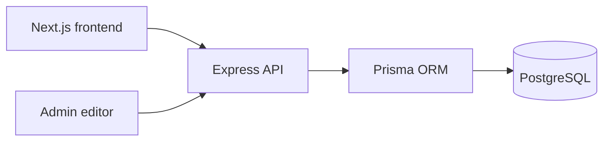

# PrepLoom Daily

PrepLoom is a full-stack space for technical interview preparation. Read structured notes, follow roadmaps, practice questions and quizzes, and watch algorithms step through code. Admins can update learning content without editing the frontend.

[Live app](https://preploom-daily.vercel.app/) · [Technical blog](https://preploom-daily.vercel.app/blog) · [Development guide](docs/DEVELOPMENT.md)

## Explore

- **Learn:** Subject notes in Learn, Revise, and Recall modes, plus roadmaps.
- **Practice:** Interview questions, quizzes, DSA sheets, and seven algorithm visualizations.
- **Manage:** An admin editor for learning content, roadmaps, and quizzes.

## Quick start with Docker

Requires Docker with Docker Compose. From the repository root:

```bash
cp compose.env.example .env
```

Set `JWT_SECRET`, `ADMIN_EMAIL`, and `ADMIN_PASSWORD` in the new root `.env`, then start the stack:

```bash
docker compose up --build
```

Open the [app](http://localhost:3000), [admin portal](http://localhost:3000/admin), or [API health check](http://localhost:4000/health). Compose starts PostgreSQL, applies Prisma migrations, seeds the learning content, and then starts the backend and frontend. Run `docker compose down` to stop it; the database remains in a named volume.

For a Node.js setup, environment variables, seed behavior, and API routes, see the [development guide](docs/DEVELOPMENT.md).

## How it fits together



The frontend handles pages and algorithm playback. Express serves learning content, grades quizzes, and protects admin edits. PostgreSQL stores editable content, admin accounts, and form submissions. The [technical blog](https://preploom-daily.vercel.app/blog) explains these decisions and includes diagrams of the main flows.

## Quality checks

```bash
npm run lint
npm run typecheck
npm test
npm run build
```

GitHub Actions runs these checks with PostgreSQL and validates the Docker Compose configuration.
